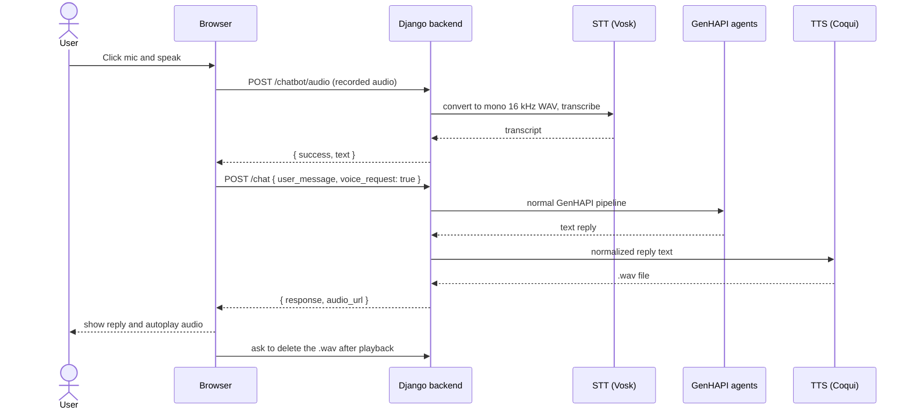

# Voice Interaction Module for a Multi-Agent Conversational System

Speech-to-text and text-to-speech integration for **GenHAPI**, a multi-agent chatbot for workflow automation. Users can talk to the system and hear its answers, while the existing agent pipeline stays untouched.

**Stack:** Python 3.11 · Django · Vosk (STT) · Coqui TTS · pydub / ffmpeg · Web Audio / MediaRecorder API · Docker

> **Context.** Bachelor's thesis project, University of Florence (UNIFI), Department of Information Engineering, A.Y. 2024-2025. Supervisors: Prof. Pietro Pala and Prof. Andrea Ferracani.
> GenHAPI was developed by the **MICC lab** of the University of Florence and is **not public**. I designed and implemented the voice module on top of it. **This repository contains only the code I wrote**, plus a technical description of how it fits into the system.
> Thesis (in Italian): *"Sviluppo di un Modulo di Interazione Vocale per un Sistema Conversazionale Multi-Agente Orientato all'Automazione"*.
<!-- TODO: se la tesi è pubblicata nel repository di ateneo UNIFI, aggiungi qui il link; altrimenti lascia così e non caricare il PDF. -->

## Highlights

- **Voice in, voice out.** Press the microphone button, speak, and the request enters the normal GenHAPI pipeline; the answer is displayed and read aloud automatically. Typing still works exactly as before.
- **Non-invasive design.** The voice logic lives in its own agent and two services. It pre-processes the user's audio and post-processes the text reply, and does not change how the agents reason.
- **Local and lightweight.** Speech recognition and synthesis run on the server CPU, with no GPU and no cloud speech API. The Italian recognition model is about 50 MB.
- **Italian text normalization for TTS.** Times, dates, numbers and alphanumeric codes are rewritten as words before synthesis, because the TTS model mispronounces them otherwise.
- **Hands-free recording.** The browser stops recording by itself when the user stops talking (volume-based voice activity detection).

## Results at a glance

Preliminary A/B evaluation, voice vs. text, on 6 automation tasks (invoice creation, search, record update, filtered queries):

| | Result |
|---|---|
| Intent recognized | in **all tasks**, in both conditions |
| Time to complete a request | voice faster in most tasks, **by about 10-35%** (e.g. 72.8 s → 46.7 s for invoice creation) |
| Transcription errors | 2, both on less common Italian terms; none in text mode |

This evaluation was run by a **single tester** (the author) simulating 5 virtual users, in quiet conditions, so it is **indicative, not statistically significant**. Details in [Evaluation](#evaluation).

## How it works



1. **Recording.** The browser records with the `MediaRecorder` API, choosing the best audio format the browser supports from a list of MIME types. A simple voice activity detector ends the recording after a period of silence.
2. **Transcription.** The backend receives the file (`.webm`, `.ogg`, `.wav`...), converts it to mono 16 kHz WAV with `pydub`, and decodes it with Vosk (`KaldiRecognizer`).
3. **Normal pipeline.** The frontend shows the transcript as a user message and sends it to the usual chat endpoint with a `voice_request` flag, so the backend knows it must also return audio.
4. **Synthesis.** The text reply is normalized for Italian and synthesized with Coqui TTS into a timestamped `.wav` file served as a static file.
5. **Playback and cleanup.** The browser autoplays the audio and then asks the backend to delete the file.

## Design decisions

| Decision | Why |
|---|---|
| Vosk for speech recognition | Italian support, works offline, small models, runs on CPU, simple Python API |
| Coqui TTS for synthesis | Many languages, easy to install, no training or fine-tuning needed |
| One `AudioAgent` wrapping both services | Voice logic stays isolated, easy to extend or replace |
| `voice_request` flag in the chat payload | The backend produces audio only when the request was spoken |
| Timestamped reply files, deleted after playback | Easier debugging, and no accumulation of audio on the server |
| Strict validation on the delete endpoint | Prefix check, filename pattern and path containment prevent deleting arbitrary files |
| Voice activity detection in the browser | No extra round trips to decide when the user has finished speaking |

### Italian text normalization

The lightweight `glow-tts` Italian model cannot read numbers, dates or codes correctly. Before synthesis, regular expressions plus `num2words` rewrite them:

| Input | Spoken as |
|---|---|
| `14:05` | "quattordici e cinque" |
| `23/09/2025` | "ventitre settembre duemilaventicinque" |
| `1200 euro` | "milleduecento euro" |
| `IT12345678` | spelled character by character |
| `76997142645` | read digit by digit |

<!-- TODO: incolla qui (in un blocco ```python) un estratto breve della funzione `normalize_italian` da `web/utils/TTS_service.py`: ti consiglio le regex per orari e date (`time_norm`, `dmy_date_norm`) e la funzione `spell_token`, circa 25 righe. -->

### Voice activity detection

Every 120 ms the browser measures the RMS volume of the microphone signal. If it stays below a threshold for 1.5 s, recording stops. The first 600 ms are ignored to avoid stopping too early, and the silence counter resets whenever voice is detected. Simplified from my implementation:

```js
const VAD_CHECK_INTERVAL_MS = 120;     // how often the volume is measured
const VAD_SILENCE_DURATION_MS = 1500;  // consecutive silence needed to auto-stop
const VAD_MIN_RECORDING_MS = 600;      // avoid stopping too early
const VAD_RMS_SILENCE_THRESHOLD = 0.012;

vadTimerId = setInterval(() => {
  if (!isRecording || !analyser) return;
  const rms = measureRMS(analyser);
  if (Date.now() - recordingStartTs < VAD_MIN_RECORDING_MS) return;

  if (rms < VAD_RMS_SILENCE_THRESHOLD) {
    vadSilenceAccumMs += VAD_CHECK_INTERVAL_MS;
    if (vadSilenceAccumMs >= VAD_SILENCE_DURATION_MS) stopRecording();
  } else {
    vadSilenceAccumMs = 0;             // voice detected: reset the silence counter
  }
}, VAD_CHECK_INTERVAL_MS);
```
<!-- TODO: nel file `web/static/js/chat.js` copia SOLO le funzioni che hai scritto tu (blocco "VAD LOGIC": startVAD, stopVAD, measureRMS, più le funzioni di registrazione e autoplay). Non incollare il resto di chat.js, che è del MICC. Salvale in un file tuo, per esempio `src/static/js/voice_recording.js`. -->

### The agent wrapper

```python
from utils.STT_service import transcribe_audio_to_text
from utils.TTS_service import generate_audio

class AudioAgent:
    """Agent specialized in speech -> text (STT) and text -> speech (TTS)."""

    def transcribe_file(self, file_path: str) -> str:
        return transcribe_audio_to_text(file_path)

    def synthesize(self, text: str) -> str:
        """Returns the absolute path of the .wav file for the reply."""
        return generate_audio(text)

audio_agent = AudioAgent()
```

## What I implemented

| Component | Role | Files |
|---|---|---|
| Audio agent | Single entry point for STT and TTS | `agents/audio_agent.py` (new) |
| STT service | Model download on first run, audio conversion, Vosk transcription | `utils/STT_service.py` (new) |
| TTS service | Coqui model loading, Italian normalization, WAV generation | `utils/TTS_service.py` (new) |
| Backend views | Audio upload and transcription endpoint, deletion of played audio | `chatbot/views.py` (two new views) |
| Chat view | `voice_request` flag, audio generation, `audio_url` in the JSON reply | `chatbot/views.py` (a few added lines) |
| Frontend | Microphone button, recording, voice activity detection, autoplay | `index.html`, `static/js/chat.js` (additions) |
| Environment | Added dependencies and runtime setup in Docker | `Dockerfile`, `environment.yml` (additions) |

Added dependencies: `vosk`, `TTS` (Coqui), `pydub`, `pysoundfile`, `libsndfile`, `ffmpeg`, `num2words`.

## Code in this repository

Only files I wrote are included here. Everything else belongs to the GenHAPI framework and stays outside this repo.

```
.
├── src/
│   ├── agents/audio_agent.py
│   ├── utils/STT_service.py
│   ├── utils/TTS_service.py
│   ├── views/voice_views.py        # transcribe_audio_view, delete_audio_played
│   └── static/js/voice_recording.js
└── docs/                           # integration notes
```
<!-- TODO: copia nella repo questi file, uno per uno:
  1. `web/agents/audio_agent.py`   -> `src/agents/audio_agent.py`       (file interamente tuo)
  2. `web/utils/STT_service.py`    -> `src/utils/STT_service.py`        (interamente tuo)
  3. `web/utils/TTS_service.py`    -> `src/utils/TTS_service.py`        (interamente tuo)
  4. da `web/chatbot/views.py` prendi SOLO `transcribe_audio_view` e `delete_audio_played` -> `src/views/voice_views.py`
  5. da `web/static/js/chat.js` prendi SOLO le funzioni che hai scritto -> `src/static/js/voice_recording.js`
  NON copiare: `views.py` completo, `urls.py`, `index.html`, `chat.js` completo, `.env` (contiene la chiave OpenAI e le password), database, cartella `models/`, audio generati. -->

### Integration notes

<!-- TODO (facoltativo, ma consigliato): per le modifiche ai file del MICC non incollare i file ma descrivile qui con 2-3 righe ciascuna, copiando solo le righe che hai AGGIUNTO: la riga di route `chatbot/audio` in `urls.py`, il bottone microfono in `index.html`, e le poche righe aggiunte nella view `chat` (flag `voice_request` e chiamata a `audio_agent.synthesize`). -->

The module plugs into an existing Django project with these changes:

- a new route `chatbot/audio` pointing to the transcription view, and static serving of the generated audio;
- a microphone button next to the "Send" button in the chat page;
- in the chat view, read `voice_request` from the request and, if true, add `audio_url` (pointing to the generated `.wav`) to the JSON reply.

Models are downloaded on first start (`vosk-model-small-it-0.22` and the Coqui `tts_models/it/mai_male/glow-tts`) and are not stored in the repo. The TTS model can be changed with the `TTS_MODEL_NAME` environment variable.

## Evaluation

**Method.** A/B comparison on 6 automation tasks: create an invoice, search invoices, retrieve customer data, update a billing address, change an invoice status, and run a search with multiple constraints.

- **Condition A (baseline):** typing the request and reading the reply.
- **Condition B:** speaking the request and hearing the reply.

Each task was phrased in 5 different ways to simulate 5 virtual users (p01-p05). Voice tests were done in quiet environments. The whole evaluation was carried out by me, so it is a demonstration of the approach, not a user study.

**Findings (tester p01 as example).**

| Task | Text (s) | Voice (s) |
|---|---:|---:|
| T1: create an invoice | 72.84 | 46.65 |
| T2: search invoices | 83.80 | 59.38 |

- Across tasks, voice reduced input time by roughly **10-35%**, with a few exceptions where it was not faster.
- The system recognized the user's intent in **every task** in both conditions, so adding voice did not reduce reliability.
- **2 transcription errors** occurred in voice mode (Vosk on less common Italian terms); both were fixed by rephrasing. No errors in text mode.

## Limitations and future work

- Evaluation with real users and in noisy environments is still missing; the current results come from a single tester.
- The small Italian Vosk model struggles with dates in different formats, alphanumeric codes and large numbers.
- Voice activity detection is a fixed volume threshold. A trained VAD would handle background noise and overlapping voices better.
- No handling of interruptions during recording or long dialogues, and Italian only: multilingual support is the natural extension.
- Prototype shortcuts: the voice endpoints are CSRF-exempt, and temporary upload and conversion files are not cleaned up yet (reply audio is deleted after playback).

## Credits and licenses

- **GenHAPI** was developed by the MICC lab, University of Florence. It is not included in this repository and is not covered by any license here. See: *GenHAPI: Conversational Orchestration over MCP to Unlock Complex Legacy Workflows* ([Springer](https://link.springer.com/chapter/10.1007/978-3-032-31048-4_15)).
- **Vosk** (Apache 2.0) and **Coqui TTS** (MPL 2.0) are used as libraries. The speech models have their own licenses.
- Thanks to Prof. Pietro Pala and Prof. Andrea Ferracani for their supervision, and to the MICC lab for making the framework available.
<!-- TODO: autori e anno dell'articolo Springer: aggiungili dalla pagina del capitolo.
TODO: aggiungi un file LICENSE (MIT) per i tuoi file SOLO dopo aver avuto il via libera dei relatori/MICC. Fino ad allora, puoi lasciare il repository senza licenza.
TODO (facoltativo): aggiungi una GIF dimostrativa solo se il laboratorio accetta che si veda l'interfaccia di GenHAPI. -->
